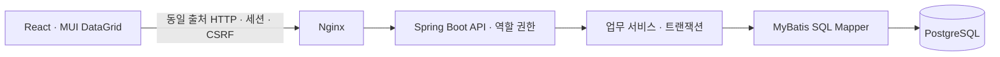
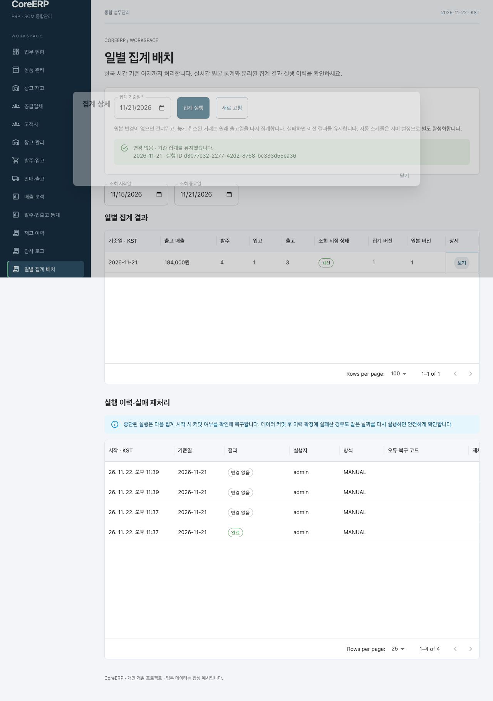
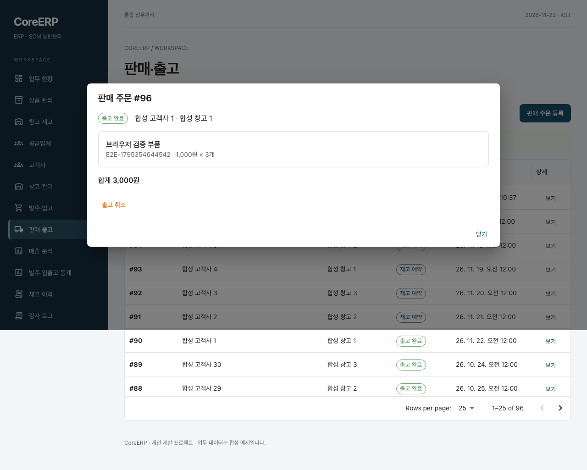

# CoreERP — ERP·SCM 통합관리

구매 발주부터 부분 입고, 창고별 재고, 판매 주문과 출고까지 연결한 **개인 개발 프로젝트**입니다. Java·SQL·업무 로직·운영 검증을 중심으로 만들었습니다. 회사 소스·실제 고객 데이터는 사용하지 않습니다.

기존 `flow-ledger`의 재고 잠금·멱등 요청·세션 보안 설계를 참고해 새 모노레포에서 확장했습니다. 기존 저장소, 게임 DB, 운영 배포본은 수정하지 않았습니다. **MVP 로컬 실행과 자동 테스트를 제공하며, 외부 운영 서버에는 배포하지 않았습니다.**

## 빠르게 살펴보기

| 확인할 내용                               | 위치                                                                                   |
| ----------------------------------------- | -------------------------------------------------------------------------------------- |
| 트랜잭션·행 잠금·부분 입고·출고 취소      | [BusinessService.java](backend/src/main/java/dev/coreerp/BusinessService.java)         |
| 직접 작성한 JOIN·CTE·윈도 함수            | [CoreMapper.xml](backend/src/main/resources/mapper/CoreMapper.xml)                     |
| 재고·상태·FK 제약조건                     | [V1__coreerp.sql](backend/src/main/resources/db/migration/V1__coreerp.sql)             |
| 동시 요청·중복 처리·강제 장애 롤백 테스트 | [CoreIntegrationTest.java](backend/src/test/java/dev/coreerp/CoreIntegrationTest.java) |
| PostgreSQL Testcontainers 구성            | [PostgresTestSupport.java](backend/src/test/java/dev/coreerp/PostgresTestSupport.java) |
| SQL 실행계획 전후 측정                    | [sql-performance.md](docs/sql-performance.md)                                          |
| API 명세                                  | [Swagger 실행 방법](docs/api.md) · [OpenAPI JSON](docs/openapi.json)                   |

## 기술 구성

- Frontend: React·TypeScript·Vite, MUI / MUI DataGrid, TanStack Query(React Query), React Hook Form, React Router
- Backend: Java 21, Spring Boot 3.5.16, Spring Security, MyBatis 3.0.5, Bean Validation, springdoc OpenAPI
- Database: PostgreSQL 17, Flyway, 직접 작성한 SQL
- 운영·검증: Docker Compose, GitHub Actions, JUnit 5·MockMvc·Testcontainers, Vitest, Playwright



## MVP 구현 범위

- ADMIN / PURCHASE / WAREHOUSE / SALES 역할, 로그인·로그아웃, 메뉴 및 API 권한
- 관리자 계정 생성·잠금/해제, 잠긴 계정의 기존 접속 차단, 로그인 성공·실패·업무 감사 로그
- 상품·공급업체·고객사·창고 등록/조회/수정/사용 중지(과거 이력 보존), 검색·서버 페이지 조회
- 창고별 현재고·예약·가용 재고, 안전재고 미만 필터, 사유를 기록하는 재고 조정
- 다품목 구매 발주 → 승인 → 품목별 부분 입고 → 입고 완료, 미입고 수량·재고 상한 검증
- 판매 주문과 원자적 재고 예약 → 전체 출고 확정 → 출고 취소 및 재고 복원
- 동시 재고 요청 행 잠금, 문서 상태 잠금, 요청 키·내용 해시를 통한 중복 반영 방지
- 한국 시간 기준 기간·상품·고객사별 출고 매출, 발주·입고·출고 건수·수량, 재고 이력
- 표준 오류 응답, Swagger, Flyway, 데이터 제약조건, 테스트·빌드·Docker 기동 CI

부분 출고·부분 출고 취소, 반품·회계 정산·세금·할인·결제, 다중 회사 테넌트, 비밀번호 변경 UI·재설정, 알림/파일 업로드는 포함하지 않습니다. **2차 일별 집계 배치는 구현·검증했습니다.** 여러 역할을 같은 사용자에 연결하는 DB 구조는 있으나 사용자 생성 UI는 한 역할씩 지정합니다.

## 2차 개발 — 일별 집계

ADMIN 전용 수동 실행과 선택형 KST 자동 스케줄을 제공합니다. 원본 버전 기반 중복 건너뛰기, 동시 실행 차단, 스냅샷 정합성, 실패 롤백·재처리 및 커밋 후 이력 복구를 구현했습니다. [설계·실행·제약](docs/daily-batch.md) · [집계 SQL](backend/src/main/resources/mapper/DailySummaryMapper.xml) · [전용 테스트](backend/src/test/java/dev/coreerp/DailySummaryIntegrationTest.java)



## 실행 — Docker Compose

Docker Engine + Compose가 필요합니다.

```sh
cp .env.example .env
# .env의 세 비밀번호를 서로 다른 임의 값으로 설정(앱 계정 12자 이상, UTF-8 72바이트 이하)
docker compose up --build -d --wait
```

- 화면: **http://localhost:8088**
- Swagger: **http://localhost:8088/swagger-ui.html**
- DB·API는 호스트 포트를 공개하지 않으며, 화면 포트도 기본 127.0.0.1에만 연결합니다.
- 로그인 계정: `admin`은 APP_ADMIN_PASSWORD, `purchase` / `warehouse` / `sales`는 APP_DEMO_PASSWORD
- demo 프로필에서 합성 상품 10,000개, 창고 3개, 공급사 20개, 고객사 30개, 발주 120건, 부분 입고 12건, 판매 주문 95건(출고 90건·예약 5건)을 처음 한 번 생성합니다.
- 신규 빈 환경은 APP_PROFILE=default로 시작합니다. demo를 넣은 DB를 운영용으로 전환하지 말고 새 DB/볼륨을 준비하세요. 프로필 변경만으로 더미데이터가 삭제되지는 않습니다.
- `docker compose down`은 컨테이너를 종료하며 DB 볼륨은 보존합니다.

## 독립 개발 실행

Java 21, Node 24, 별도 PostgreSQL DB가 필요합니다. Maven Wrapper를 포함했습니다.

```sh
# DB_URL=jdbc:postgresql://localhost:5432/coreerp
# DB_USER, DB_PASSWORD, APP_ADMIN_PASSWORD, APP_DEMO_PASSWORD를 로컬 환경에 설정
cd backend
./mvnw spring-boot:run -Dspring-boot.run.profiles=demo
```

다른 터미널:

```sh
cd frontend
npm ci
npm run dev
```

프런트 http://127.0.0.1:5173 은 `/api`와 Swagger 경로를 8080 API로 프록시합니다. Java API만 별도로 실행하거나 React 화면만 개발할 수 있습니다. API가 없으면 화면의 실제 조회·변경은 작동하지 않습니다. 브라우저 저장 기반의 가짜 업무 데이터로 대체하지 않습니다.

## 검증

[커버리지 측정·전후 비교·남은 검증](docs/coverage.md): Java 라인 84.66%·분기 77.04%, React 라인 74.54%·분기 72.94%. 전체 소스를 포함한 로컬 측정이며 Playwright 커버리지는 합산하지 않습니다.

```sh
cd backend
./mvnw verify                         # Docker에서 PostgreSQL 17 Testcontainers 자동 실행
cd ../frontend
npm ci
npm test
npm run build
npx playwright install chromium
# demo API와 Vite를 실행하고 APP_ADMIN_PASSWORD / APP_DEMO_PASSWORD를 설정한 뒤
npm run test:e2e
```

로컬에 Docker가 없으면 테스트 전용 PostgreSQL의 DB_URL / DB_USER / DB_PASSWORD를 지정해 같은 Java 테스트를 실행할 수 있습니다. 테스트는 초기화 전 DB 이름이 `_test`로 끝나는지 검사하며 업무 테이블을 비웁니다. **실제 데이터베이스에는 테스트 주소를 연결하지 마세요.**

검증 항목: 초과 출고/예약 거부, 동시 요청 재고 정합성, 중복 출고 단일 차감, 부분 입고 초과 거부, 강제 DB 장애 전체 롤백, 권한·CSRF·계정 상태, 원본 거래와 SQL 집계 일치. 브라우저는 실제 API로 상품 생성 → 발주 → 두 번 부분 입고 → 판매 예약 → 출고 → 취소 후 재고 복원, 모바일 메뉴, 1만 상품 페이지 이동·검색을 검사합니다.

검증 완료: Java 단위·통합 테스트 52개, 프런트 단위·컴포넌트 테스트 39개, 브라우저 검사 4개. [GitHub Actions 5개 작업 전체 성공](https://github.com/kimsoonil/CoreERP/actions/runs/45035789487). CI는 같은 코드의 Testcontainers, 프런트, 브라우저, Docker 기동, SQL 벤치마크를 실행하며 원격 결과는 Actions 기록을 확인하세요. 미실행 검사를 통과했다고 간주하지 않습니다.

## 설계·측정·포트폴리오 문서

- [구조와 역할](docs/architecture.md)
- [ERD와 테이블 제약](docs/erd.md)
- [업무 상태·잠금·재시도](docs/business-flow.md)
- [API·권한·오류 응답](docs/api.md)
- [SQL 성능 전후 측정·재현](docs/sql-performance.md)
- [Java·React 테스트 구성과 실행](docs/testing.md)
- [검증 및 문제 해결](docs/troubleshooting.md)
- [이력서용 프로젝트 요약](docs/resume-summary.md)



운영 서버 공개 전에는 TLS/COOKIE_SECURE, 비밀 관리, DB 최소 권한·백업, 로그인 요청 제한·비밀번호 재설정 절차, 세션 만료와 감사 로그 보존 정책을 마련해야 합니다. 현재 로컬 실행 설정을 곧바로 외부 서비스 운영 보장으로 보지 않습니다.
