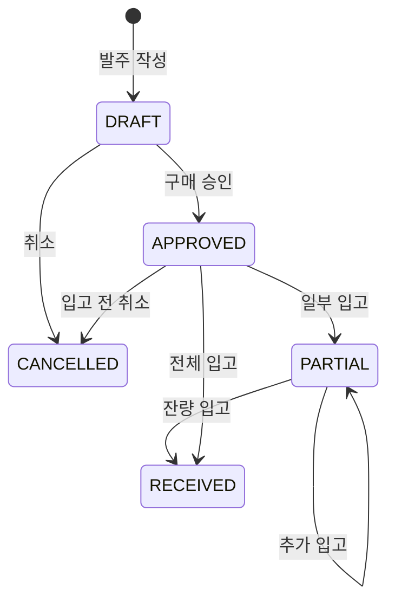
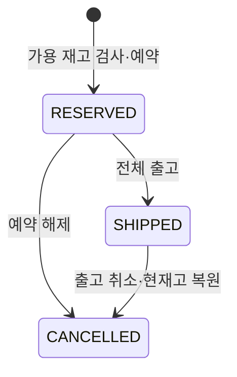

# 업무 흐름과 동시성

입고는 승인/부분 입고에서만 가능합니다. 요청 수량이 품목별 미입고 수량을 초과하면 거부합니다. 입고 문서·품목·재고 증가·입고 누적·상태·이력·멱등 결과를 한 트랜잭션에 기록합니다. 입고 후 발주 취소는 지원하지 않습니다.

판매 주문 저장 시 모든 품목의 가용 재고가 충분해야 합니다. 한 품목이라도 부족하면 주문·예약 전체를 롤백합니다. 출고 확정은 현재고와 예약을 함께 차감합니다. 예약 취소는 예약만 해제하며, 출고 취소는 출고 문서를 CANCELLED로 바꾸고 현재고만 복원합니다. 취소 주문을 다시 출고하지 않으며 새 주문을 생성해야 합니다.

## 잠금 순서

1. 요청 키 advisory transaction lock → 기존 내용 해시 검증.
2. 기존 발주/주문을 처리하면 문서 행을 FOR UPDATE로 잠금.
3. 같은 창고 안의 상품 ID 오름차순으로 재고 행을 잠금. 판매 입력 품목 순서가 달라도 잠금 순서는 같음.
4. 유효성 검사 → 변경 → 감사/이력/요청 결과 저장 → 커밋.

재고 행이 없으면 INSERT ON CONFLICT DO NOTHING 후 SELECT FOR UPDATE 합니다. DB CHECK도 예약·현재고 범위를 검사합니다. 요청 키는 operation+UUID로 전역 범위를 갖습니다. 재시도는 같은 키·같은 내용에 기존 결과를 반환하고 내용이 바뀌면 409입니다. 생성·입고·출고·수동 조정에 적용합니다. 출고 재요청은 주문 상태와 출고 UNIQUE도 확인해 다른 키가 와도 이중 차감하지 않습니다.

클라이언트는 같은 내용의 실패 재시도에 키를 유지하고 성공 후 초기화합니다. 새로고침 후 키 복원과 멱등 키의 정기 삭제는 현재 제공하지 않습니다. 만료 없이 저장하므로 운영 시 보관 정책이 필요합니다.

## 매출·통계 기준

현재 CONFIRMED인 출고의 판매가 스냅샷×출고 수량을 출고일에 집계합니다. 출고 취소된 문서는 과거 조회에서도 제외됩니다. 반품일 차감식 회계 보고서가 아닙니다. 기간은 Asia/Seoul 기준 `[시작일 00:00, 종료일 다음 날 00:00)`이며 최대 366일입니다. 상품·고객사 매출은 상위 100개로 표시합니다. 일별 발주·입고·출고 통계는 각각의 문서 일자를 사용합니다.

## 2차 일별 집계

[집계 기준·API·권한·트랜잭션·장애 재처리 문서](daily-batch.md)를 참고하세요.
