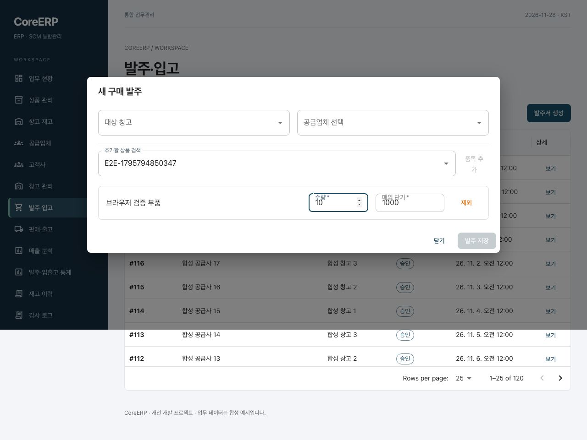
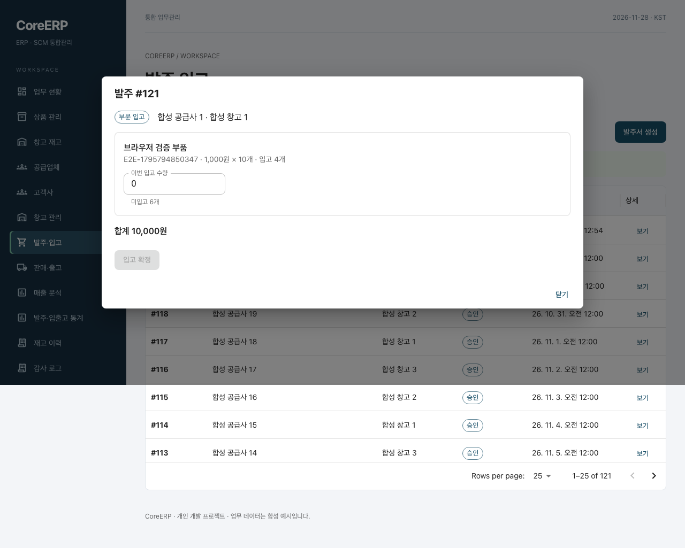
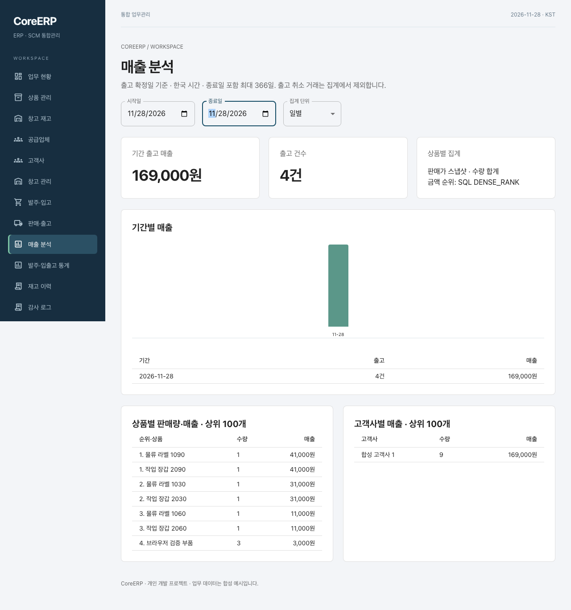
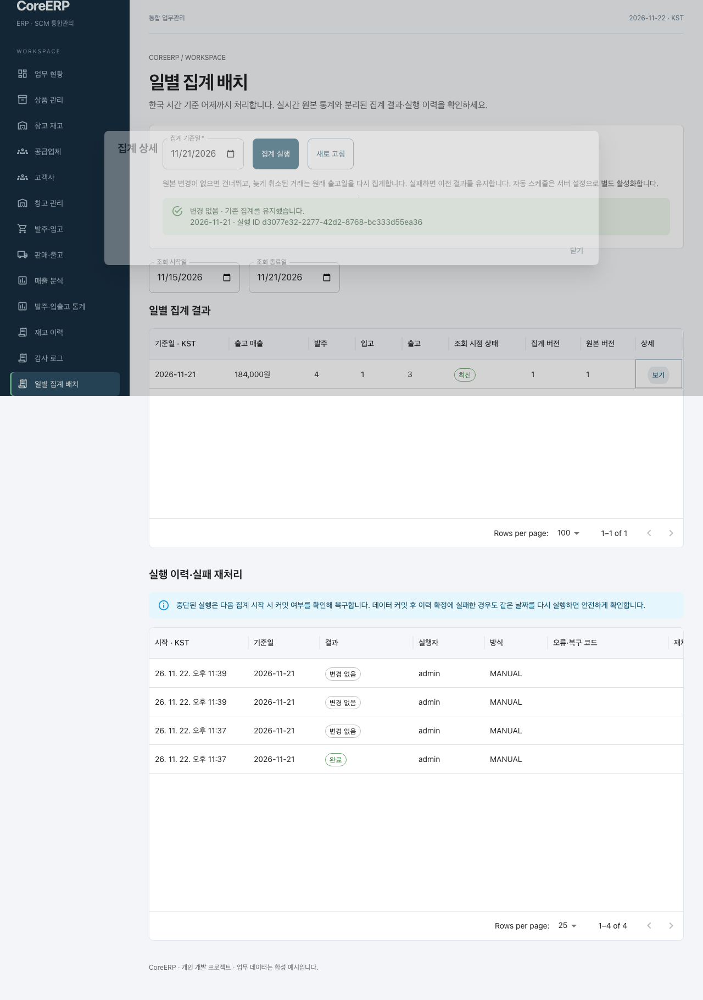

# CoreERP 업무 시연 가이드

**개인 프로젝트 · 운영 배포 전.** 공개 운영 서비스나 실사용 고객 데이터가 아닙니다. 아래는 로컬 실제 API·PostgreSQL과 합성 데이터를 사용하는 시연입니다. 비밀번호는 `.env`에서 직접 설정하며 화면·문서에 공개하지 않습니다.

## 채용 담당자가 5분 안에 확인할 순서

1. [README](../README.md)의 Docker Compose로 실행하고 `http://localhost:8088`에서 admin으로 로그인합니다. 구매·창고·영업 계정으로 역할별 메뉴도 비교할 수 있습니다.
2. 상품 관리에서 고유 SKU(예: `DEMO-날짜-일련번호`)를 등록합니다. 이름은 ‘시연 부품’, 판매가는 1,000원으로 설정합니다. 기존 더미 상품을 수정하지 않습니다.
3. 발주·입고에서 창고 1·공급사 1과 새 상품을 선택해 10개를 발주하고 승인합니다. 매입 단가는 매출 계산에 사용하지 않습니다.
4. 4개 입고 후 ‘부분 입고’, 나머지 6개 입고 후 ‘입고 완료’를 확인합니다.
5. 판매·출고에서 같은 창고·고객사 1·같은 상품 3개를 주문합니다. 재고는 예약되지만 아직 매출은 발생하지 않습니다.
6. 출고 확정 후 오늘의 매출 분석을 확인합니다. 해당 상품 판매량 3개·매출 3,000원, 전체 매출은 시연 전 대비 3,000원 증가합니다.
7. 출고 취소 후 재고와 매출을 다시 조회합니다. 현재고 10개·예약 0개, 해당 상품 매출 제외와 전체 매출 원복을 확인합니다.
8. 일별 집계 배치에서 **KST 어제**를 실행합니다. 원본 매출과 집계 상세를 비교하고 같은 날짜를 다시 실행해 ‘변경 없음(SKIPPED)’과 기존 집계 run ID 보존을 확인합니다. 당일 거래는 마감 전이므로 당일 배치에 넣지 않습니다.

| 단계 | 현재고 | 예약 | 가용 | 이 시연 상품의 출고 매출 |
| --- | ---: | ---: | ---: | ---: |
| 상품 등록·발주 승인 | 0 | 0 | 0 | 0원 |
| 1차 입고 4개 | 4 | 0 | 4 | 0원 |
| 2차 입고 6개 | 10 | 0 | 10 | 0원 |
| 주문 3개 예약 | 10 | 3 | 7 | 0원 |
| 출고 확정 | 7 | 0 | 7 | 3,000원 |
| 출고 취소 | 10 | 0 | 10 | 0원 |

기존 합성 매출이 있으므로 전체 매출이 처음부터 0이라고 가정하지 않습니다. 새 SKU와 전후 차이로 확인합니다. ‘출고 취소’는 원 출고일 매출을 소급 제외하는 모델이며, 반품·환불·회계 전표 처리가 아닙니다.

## 실제 실행 화면

### 발주서 작성


### 첫 입고 후 부분 입고 상태


### 출고 후 매출 확인


### 닫힌 날짜의 집계·중복 실행


화면 이미지는 자동 브라우저 검증에서 수집한 합성 데이터입니다. 실시간 서버 화면이나 연속 녹화 영상은 아닙니다. 시연을 반복하면 SKU·문서 번호·날짜·전체 매출은 달라집니다.

## 자동으로 같은 흐름 재현

demo API와 프런트엔드를 실행하고 두 비밀번호 환경변수를 설정한 뒤:

```sh
cd frontend
npm ci
npx playwright install chromium
npm run test:e2e
```

`e2e/core-flow.spec.ts`는 화면 입력으로 업무를 진행하며 실제 API의 기간·상품 매출을 전후 대조합니다. `e2e/daily-batch.spec.ts`는 어제의 원본과 배치를 대조하고 중복 실행을 검사합니다. 이미지는 `frontend/test-results/`, CI에서는 `browser-results` 아티팩트에 보관됩니다. 테스트는 전용 로컬 합성 DB에서 실행하세요.

## 함께 읽을 자료

- [SQL·동시성 설계와 코드 위치](sql-concurrency.md)
- [배치의 스냅샷·실패 복구](daily-batch.md)
- [운영 준비와 남은 검증](operations.md)
