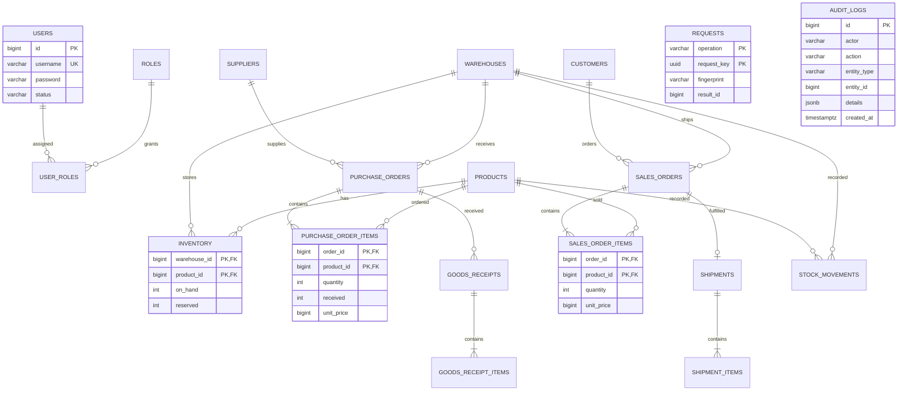
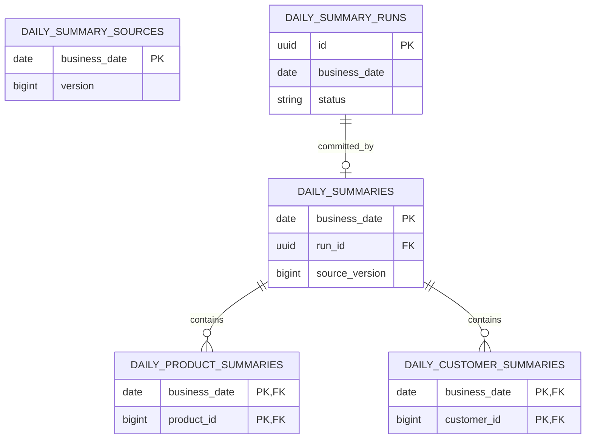

# ERD와 데이터 제약

## 핵심 불변식

- inventory: `0 <= reserved <= on_hand <= 1,000,000`. 가용 수량은 on_hand − reserved.
- 주문 품목 수량: 1~1,000,000, 단가 0~1,000,000,000원 정수. 구매 누적 입고는 발주 수량 이하.
- 한 문서의 같은 상품은 복합 PK로 중복 저장하지 않고 요청에서 합산합니다. 구매 단가가 다르면 합산하지 않고 거부합니다.
- shipments.sales_order_id UNIQUE: 한 판매 주문에 하나의 출고 문서. 부분 출고는 지원하지 않습니다.
- SKU·거래처/창고 코드·사용자 이름은 UNIQUE. 참조키로 기준정보 삭제 시 거래가 고아가 되지 않도록 하고, API의 삭제는 사용 중지로 처리합니다.
- FK·CHECK는 DB에서 기본 무결성을 보호합니다. 여러 행의 입고 합계·문서 상태 전이는 서비스의 잠금·트랜잭션으로 검증합니다. 임의의 직접 SQL 쓰기에 모든 업무 규칙이 자동 적용되는 것은 아닙니다.
- 금액 bigint 곱셈은 설정한 범위에서 bigint 이내이며 sum은 PostgreSQL numeric으로 집계 후 문자열로 전달합니다. 화면은 BigInt로 합산·표시합니다.

재고 초기 데이터·입고·출고·출고 취소·조정은 stock_movements의 증감과 함께 기록합니다. 예약은 현재고 이동이 아니므로 stock_movements 대신 주문 상태와 audit_logs에 기록합니다. actor는 당시 계정명을 보존하는 문자열이며 비밀번호·고객 개인정보는 감사 정보에 넣지 않습니다.

## 2차 일별 집계

[집계 기준·API·권한·트랜잭션·장애 재처리 문서](daily-batch.md)를 참고하세요.

원본 버전은 업무 변경과 같은 트랜잭션에서 증가합니다. 집계 헤더 삭제 시 상세는 CASCADE로 교체되며 실행 이력은 보존합니다.
