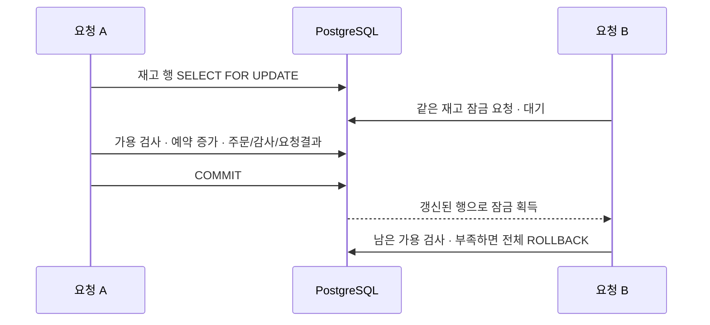

# SQL과 동시성 설계 설명

## 지키려는 업무 불변식

창고×상품별로 `0 <= reserved <= on_hand <= 1,000,000`, 가용 재고는 `on_hand - reserved`입니다. 재고를 읽고 나중에 별도 요청으로 차감하면 두 주문이 같은 가용 수량을 사용할 수 있으므로, **행 잠금 뒤 검사와 변경을 같은 트랜잭션에서** 수행합니다.

[BusinessService](../backend/src/main/java/dev/coreerp/BusinessService.java)의 `createSale`, `receive`, `ship`, `cancelShipment`와 [잠금·변경 SQL](../backend/src/main/java/dev/coreerp/CoreMapper.java), [DB 제약](../backend/src/main/resources/db/migration/V1__coreerp.sql)을 함께 읽으면 됩니다.

## 두 요청이 같은 재고를 주문하면

재고 행이 없으면 `INSERT ... ON CONFLICT DO NOTHING` 후 잠급니다. 문서가 있으면 먼저 문서 행을 잠그고, 여러 상품은 ID 오름차순으로 잠급니다. 입력 품목 순서가 달라도 같은 순서를 사용해 교착 가능성을 줄입니다. 이 설계가 모든 외부 SQL·미래 기능의 교착을 없앤다는 뜻은 아닙니다.

출고와 예약 취소가 경합하면 동일 주문 행의 잠금으로 직렬화됩니다. 출고가 먼저면 주문은 SHIPPED가 되고 예약 취소는 거부됩니다. 취소가 먼저면 CANCELLED가 되어 출고가 거부됩니다. 서로 성공해 예약이 두 번 해제되는 결과는 허용하지 않습니다.

## 중복 요청과 동시 요청은 다르게 처리

| 상황 | 적용 장치 | 결과 |
| --- | --- | --- |
| 같은 요청 키·같은 내용 재시도 | operation+UUID advisory transaction lock, 내용 해시, 결과 저장 | 기존 결과 반환 |
| 같은 키·다른 내용 | 내용 해시 비교 | 409 충돌 |
| 다른 키로 동일 주문 재출고 | 주문 행 잠금, 상태 확인, 출고의 주문 UNIQUE | 기존 출고 반환·단일 차감 |
| 여러 상품 처리 중 두 번째 쓰기 실패 | Spring `@Transactional` | 문서·재고·이력·요청결과 전체 롤백 |

잠금은 커밋/롤백 시 해제됩니다. 기본 업무 트랜잭션은 PostgreSQL READ COMMITTED와 명시적 행 잠금을 사용하며, 집계 배치는 별도로 REPEATABLE READ 스냅샷을 사용합니다. 요청 키는 현재 만료 없이 보관하며 클라이언트 새로고침 후 복구는 미지원입니다.

## SQL을 직접 작성한 이유와 주의한 점

- **JOIN:** 확정 출고 → 출고 품목 → 주문 품목을 문서 ID와 상품 ID로 연결해 주문 시점 판매가를 사용합니다. 현재 상품 가격을 바꿔도 과거 매출이 바뀌지 않습니다.
- **CTE·윈도 함수:** `productSales`는 먼저 상품별 수량·금액을 집계한 뒤 `DENSE_RANK()`를 적용합니다. 동액은 같은 순위입니다. 상품·고객사 화면은 상위 100개이므로 이를 합쳐 전체 매출로 간주하지 않습니다.
- **FULL JOIN:** `flowStats`는 발주·입고·출고를 각각 일별 집계한 뒤 결합합니다. 거래 종류별 원본을 직접 한 번에 JOIN할 때 생기는 행 증식과 합계 중복을 피하고, 입고만 있는 날짜도 보존합니다.
- **기간:** KST 시작일 00시 이상·종료일 다음 날 00시 미만의 반개구간을 API에서 계산합니다. 날짜별 분류도 KST를 사용합니다.
- **금액:** PostgreSQL의 합계는 문자열로 반환하고 React에서는 BigInt로 더합니다. 큰 금액을 JS Number로 변환해 정밀도를 잃지 않도록 합니다.

실제 쿼리는 [CoreMapper.xml](../backend/src/main/resources/mapper/CoreMapper.xml), 일별 집계는 [DailySummaryMapper.xml](../backend/src/main/resources/mapper/DailySummaryMapper.xml)에 있습니다. [인덱스 측정](sql-performance.md)은 20만 행의 특정 창고·상품·기간 조회만 대상으로 하며 전체 ERP 처리량을 뜻하지 않습니다.

## 검증 근거와 한계

[CoreIntegrationTest](../backend/src/test/java/dev/coreerp/CoreIntegrationTest.java): 재고 5개에 주문 48건, 동일 주문 출고 24건, 동일 키 주문 16건, 역순 다품목 잠금, 입고·출고 강제 장애 롤백, KST 집계 경계와 단가 스냅샷, 출고·예약 취소 경합을 검증합니다. 경합 테스트는 시작 장벽으로 두 트랜잭션을 출발시키고 12회 반복해 한쪽만 성공·예약 0·정상 현재고·출고 및 감사 기록 수를 확인합니다. 두 승리 순서를 매 실행에서 모두 관측한다는 보장은 없습니다.

[브라우저 테스트](../frontend/e2e/core-flow.spec.ts)는 실제 화면과 API로 출고 시 3,000원 증가·취소 시 원복을 확인합니다. [배치 테스트](../backend/src/test/java/dev/coreerp/DailySummaryIntegrationTest.java)는 원본 정합성·실패 롤백·재처리·동시 실행을 별도로 확인합니다.

다중 서버 부하 시험, 네트워크 단절·DB failover, 잠금 대기시간 SLO는 아직 검증하지 않았습니다. 부분 출고·반품·회계 정산·다중 회사는 현재 범위 밖입니다.
